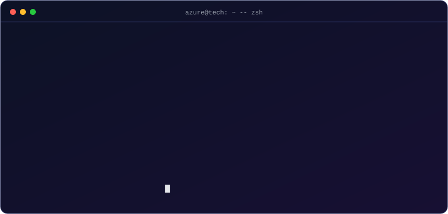
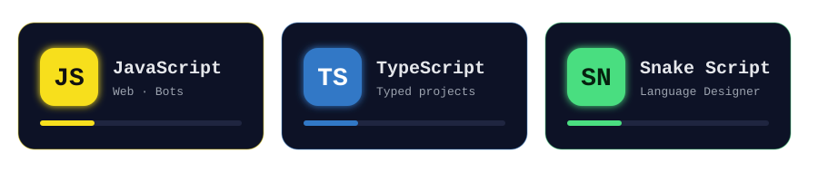

<div align="center">


[;Web+%E2%80%A2+Bots+%E2%80%A2+Programming+Languages;Design+%E2%86%92+Build+%E2%86%92+Ship)](https://github.com/reinhald90)


<br/>



</div>

## whoami



```ts
type Focus =
  | "Web Development"
  | "Bots"
  | "Programming Languages"
  | "Open Source";

interface Developer {
  readonly username: string;
  readonly alias: string;
  readonly role: string;
  readonly creator: string;
  readonly focus: readonly Focus[];
  readonly motto: string;
}

const me: Developer = {
  username: "reinhald90",
  alias: "Azure Tech",
  role: "Developer & Language Designer",
  creator: "Snake Script (SN)",
  focus: ["Web Development", "Bots", "Programming Languages"],
  motto: "design -> build -> ship",
};
```

## Tech Stack

<div align="center">


</div>

## Featured Projects

| Repo | Bahasa |
| --- | --- |
| [nano-payload-v1.0.0](https://github.com/reinhald90/nano-payload-v1.0.0) | JavaScript |
| [ashiro-cultivasion](https://github.com/reinhald90/ashiro-cultivasion) | JavaScript |
| [ashiro-motion-pitcure](https://github.com/reinhald90/ashiro-motion-pitcure) | TypeScript |

## Stats


## Languages



## Say Hi

<div align="center">



</div>


